# Capítulos 5, 6 y 7 del Informe Final (Formato APA 7) — SentinelNutri-HVC

**Proyecto:** SentinelNutri-HVC: Sistema Inteligente de Alerta Temprana para el Sistema 4 del MSV, Región Huancavelica  
**Curso:** Modelo de Sistema Viable (MSV) — FIIS UNI  
**Autor:** Elvis Arboleda, Steven Cadillo, Cheddi Gastiaburu, Gary Fernandez  
**Docente:** Ing. Ricardo Rodríguez-Ulloa  
**Corte de avance técnico:** 23 de noviembre de 2026 (Regla Fija 4 de Equilibrio Axiológico Parra Luna, gobernanza HITL con huellas `SHA-256`, auditoría consolidada `/governance/audit` y suite `24/24`)  

---

## Capítulo 5. Implementación Cibernética del Sistema 4 y Mecanismos de Variedad (Ley de Ashby)

### 5.1. Materialización del Atenuador y del Amplificador de Variedad

De acuerdo con la Ley de la Variedad Requerida de Ashby (1956) y el Modelo de Sistema Viable de Beer (1972, 1979), la viabilidad del Gobierno Regional de Huancavelica frente al problema crónico de la desnutrición crónica infantil (DCI, $20,3\,\%$ de línea base regional frente al $12,1\,\%$ nacional) exige equilibrar la variedad ambiental de los **100 distritos** de sus **7 provincias** con la capacidad de respuesta de la Gerencia Regional de Desarrollo Social (**S3**) y del Consejo Regional (**S5**).

El sistema **SentinelNutri-HVC** materializa este equilibrio mediante dos mecanismos cibernéticos complementarios desplegados en una infraestructura dual de costo cero (**Equipo 1: Estación de Desarrollo Windows 11 + Google Colab** y **Equipo 2: Servidor Local Windows 10 con Docker en SSD `C:\SentinelNutri\ssd`, almacén en HDD 1 TB `D:\SentinelNutri\hdd` y GPU NVIDIA GTX 1050 de 4 GB**):

1. **Atenuador de Variedad Ambiental (`CatBoost + SHAP`):** Comprime `1 100` registros históricos distritales (`2014–2024`, $100\text{ distritos} \times 11\text{ años}$, $26$ variables en la matriz consolidada) distribuidos en cinco dimensiones —antropométrica/nutricional, socioeconómica, acceso a servicios de agua y salud, ejecución presupuestal del Programa Articulado Nutricional `0001` / programas MIDIS y régimen climático de heladas del SENAMHI— en una probabilidad calibrada de riesgo crítico y una tasa proyectada de DCI por distrito. El modelo entrenado (`catboost_dci_hvc.cbm`, $364\,624\text{ bytes}$) se aloja en `data/models/` y en el HDD del Equipo 2.
2. **Amplificador de Variedad de Gestión (Agente Supervisor en `n8n` + LLM Gateway con Failover):** Transforma las predicciones y los valores SHAP en informes ejecutivos y recomendaciones diferenciadas por provincia y sector (**Salud/DIRESA**, **Agua y Saneamiento/DRVCS**, **Agricultura/MIDIS/MEF**) alineadas a los Objetivos Estratégicos Institucionales (**OEI**) del **PEI 2020–2027 Ampliado** del GORE Huancavelica. La orquestación en `n8n` (`AI Agent v3.1`) opera con herramientas `@n8n/n8n-nodes-langchain.toolCode` conectadas al microservicio FastAPI (`:8000`), priorizando **Ollama (`llama3.2` con backend Vulkan en GTX 1050)** para la invocación local de herramientas y **Gemini (`gemini-flash-lite-latest`, nivel gratuito de Google AI Studio)** para la síntesis narrativa rápida y conmutación automática por fallo (*failover* de 3 niveles hasta plantilla determinista MSV).

### 5.2. Las 6 Herramientas del Agente Supervisor y las 4 Reglas Fijas Cibernético-Axiológicas

Siguiendo los criterios de gobernanza algorítmica para el sector público de la CEPAL (Clavijo, 2026) y el principio de equilibrio axiológico de Parra Luna (2017, 2018), el Agente Supervisor dispone de **6 herramientas** (`extraer_fuentes`, `consultar_bd`, `predecir_riesgo`, `explicar_riesgo`, `redactar_informe` y `notificar`) con salidas compactadas para proteger su ventana de contexto y un nodo normalizador (`Normalizar Salida S4 para Reglas Fijas`), pero **cuatro decisiones críticas permanecen en Reglas Fijas deterministas** estrictamente fuera del alcance del LLM:

- **Regla Fija 1 (Inferencia Numérica Determinista):** La proyección de DCI y la probabilidad de riesgo las calcula exclusivamente el motor `CatBoost` (`/predict`), impidiendo cualquier estimación numérica inventada por el LLM.
- **Regla Fija 2 (Canal Algedónico Automatizado $\text{S1/S4} \rightarrow \text{S5}$):** Un nodo condicional fijo (`IF`) evalúa si la DCI proyectada supera el umbral crítico del **$25,0\,\%$**. Cuando se supera, la señal algedónica se despacha directamente al **Sistema 5 (Consejo Regional)** mediante Telegram Bot API real (`sendMessage` con reintentos) y queda trazada con huella criptográfica `SHA-256` (`huella_auditoria_sha256`) sin posibilidad de omisión ni demora por parte del agente.
- **Regla Fija 3 (Aprobación Humana en el Canal de Control $\text{S4} \rightarrow \text{S3}$):** Toda recomendación dirigida al **Sistema 3 (Gerencia Regional de Desarrollo Social)** nace en estado `PENDIENTE_APROBACION` (`publicado_en_canal_control_s3 = False`) y requiere aprobación humana explícita con autoridad identificable (`approver_name >= 3` caracteres) mediante nodo `sendAndWait` en Telegram (compuerta `¿Aprobado por Humano S3?`) antes de confirmarse vía `POST /hitl/aprobar/{alert_id}` hacia `APROBADO_S3` con huella de resolución `SHA-256` (`huella_resolucion_sha256`).
- **Regla Fija 4 (Equilibrio Axiológico PRVU y Abanico Equilibrador):** Evaluada de forma determinista en [`parra_luna_axiological.py`](../src/sentinelnutri/domain/rules/parra_luna_axiological.py) (`evaluate_axiological_governance_rule`), detecta colapsos estructurales ($\text{ISDH}_{\text{HVC,geom}} < 45{,}0\,\%$ o $\sigma_Y \ge 0{,}22$), **espejismos asistenciales** ($\text{Se} \ge 85\,\%$ coexistiendo con $\text{JD} < 40\,\%$ o $\text{CN} < 35\,\%$), **alertas tempranas pre-algedónicas** (colapso axiológico previo a superar $25\,\%$ de DCI) y mapea el cuello de botella PRVU de cada distrito a su OEI/ODS y sector responsable del GORE Huancavelica.

### 5.2.1. Estructura Detallada de los Flujos Agénticos en `n8n` (17 + 2 Nodos)

La automatización operativa del Sistema 4 reside en dos flujos JSON importados en `n8n` (`sentinelnutri_n8n_supervisor`, puerto `:5678`), cuya topología completa se detalla en la **Tabla 1** y se ilustra en la **Figura 1**:

- **Flujo Principal (`workflows_n8n/01_ciclo_supervisor_sentinelnutri.json`, `17` nodos):**
  1. *Inicio y Orquestación Cognitiva (`S4`):* `Regla Fija 1: Schedule Trigger (Inicio Semanal)` (`n8n-nodes-base.scheduleTrigger`) activa semanalmente al `Agente Supervisor (AI Agent de n8n)` (`@n8n/n8n-nodes-langchain.agent` v3.1, con `needsFallback: true`). El agente enlaza dos modelos de lenguaje en cascada (`ai_languageModel`: índice `[0]` **Ollama Local Llama 3.2 en GTX 1050** y respaldo `[1]` **Gemini `gemini-flash-lite-latest`**) y seis nodos `ai_tool` (`toolCode` v1.1) conectados vía HTTP REST al microservicio `api_engine:8000` (`extraer_fuentes`, `consultar_bd`, `predecir_riesgo`, `explicar_riesgo`, `redactar_informe` y `notificar`).
  2. *Normalización Determinista y Regla Fija 2 ($\text{S1/S4} \rightarrow \text{S5}$):* La salida del agente ingresa al nodo `Normalizar Salida S4 para Reglas Fijas` (`Code` v2), que extrae `dci_proyectada_pct` e `id_alerta` y evalúa las métricas axiológicas de la **Regla Fija 4**. Acto seguido, `Regla Fija 2: Nodo IF · Umbral de Riesgo` (`if` v2) verifica estrictamente `dci_proyectada_pct > 25`. Si resulta `true`, despacha de inmediato `Canal Algedónico S5: Despacho Inmediato (Consejo Regional)` vía Telegram (`sendMessage`) y, tanto por rama `true` como por rama `false`, enruta el caso hacia la compuerta humana de Control.
  3. *Regla Fija 3 HITL y Bifurcación Dual `Approve / Decline` ($\text{S4} \rightarrow \text{S3}$):* El nodo `Regla Fija 3: Aprobación Humana` (`telegram` v1.2 en modo `sendAndWait` expuesto por **Cloudflare Tunnel**) suspende la publicación enviando botones interactivos `Approve` / `Decline`. La respuesta alimenta a `¿Aprobado por Humano S3?` (`if` v1, condición `approved === true`), bifurcando hacia `Confirmar Aprobación HITL hacia S3` (`POST /hitl/aprobar/{id_alerta}`, `approved = true`, estado `APROBADO_S3`) o hacia `Registrar Rechazo HITL S3` (`POST /hitl/aprobar/{id_alerta}`, `approved = false`, estado `RECHAZADO`), ambos persistidos con huella criptográfica `SHA-256`.
- **Flujo Secundario de Autovigilancia (`workflows_n8n/02_vigilancia_fallos_scrapers.json`, `2` nodos):** `Error Trigger (Fallo en Scraper por Cambio de Diseño de Portal)` captura cualquier excepción en tiempo de ejecución y dispara `Notificar Desviación por Telegram` hacia el canal técnico administrativo.

**Tabla 1**  
*Arquitectura de Nodos, Tipos y Roles MSV en los Flujos `n8n` de SentinelNutri-HVC (`17 + 2` Nodos)*

| Flujo / Etapa MSV | Nodo(s) en `n8n` (Cantidad) | Tipo / Versión `n8n` | Rol Cibernético y Conexión |
| :--- | :--- | :--- | :--- |
| **1. Disparo S4** | `Schedule Trigger` (1) | `scheduleTrigger` v1.2 | Regla Fija 1: inicia el ciclo semanal → `AI Agent` |
| **2. Cerebro S4 + LLM** | `AI Agent` (1) + `Ollama` / `Gemini` (2) | `agent` v3.1 + `lmChat*` v1 | Orquesta S4 con `needsFallback: true` (`[0]` GTX 1050 → `[1]` Gemini) |
| **3. 6 Herramientas REST** | `Tool 1` a `Tool 6` (`toolCode`) (6) | `toolCode` v1.1 (`ai_tool`) | Invocan `:8000/tools/*` (`extraer`, `bd`, `predict`, `shap`, `redactar`, `notificar`) |
| **4. Puente + Regla Fija 2** | `Normalizar Salida S4` + `Nodo IF > 25 %` (2) | `code` v2 + `if` v2 | Normaliza `id_alerta`/DCI; `true` → `Canal Algedónico S5` (Telegram `sendMessage`, 1) |
| **5. Regla Fija 3 (HITL S3)** | `Telegram sendAndWait` + `¿Aprobado S3?` (2) | `telegram` v1.2 + `if` v1 | Pausa hasta respuesta móvil HTTPS (Cloudflare Tunnel) y evalúa `approved === true` |
| **6. Cierre HITL (`S3`)** | `Confirmar HITL S3` (`true`) / `Registrar Rechazo` (`false`) (2) | `httpRequest` v4.2 | Invocan `POST /hitl/aprobar/{id_alerta}` (`APROBADO_S3` o `RECHAZADO` con `SHA-256`) |
| **7. Autovigilancia (Flujo 2)** | `Error Trigger` + `Notificar Desviación Telegram` (2) | `errorTrigger` v1 + `telegram` v1.2 | Alerta técnica inmediata ante cambios HTML o fallos de portales |

**Figura 1**  
*Estructura Completa de los Flujos Agénticos en `n8n`: Orquestador `AI Agent v3.1` (`17` Nodos), `6 × toolCode`, 3 Reglas Fijas en Grafo, Bifurcación `Approve/Decline` y Vigilancia de Errores (`2` Nodos)*

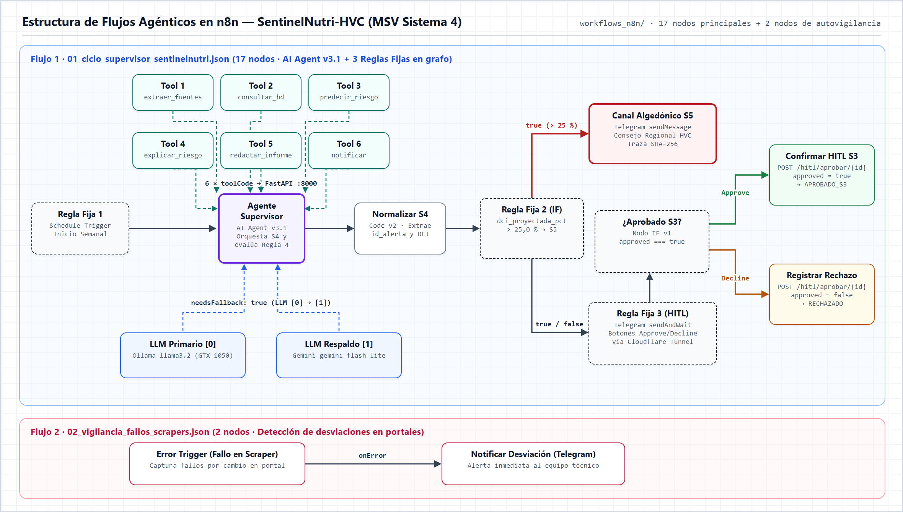

*Nota.* Elaboración propia a partir de la topología real exportada en `workflows_n8n/01_ciclo_supervisor_sentinelnutri.json` (`17` nodos) y `workflows_n8n/02_vigilancia_fallos_scrapers.json` (`2` nodos). Archivo de alta resolución: [`fig6_estructura_flujo_n8n_msv.png`](figures/fig6_estructura_flujo_n8n_msv.png).

### 5.3. Sustento Teórico, Operativo y Estadístico del Sistema de Indicadores Vigentes

Antes de evaluar en la siguiente etapa el marco de indicadores sistémicos de Parra Luna, se consolidan y sustentan los **indicadores observacionales y territoriales actualmente integrados** en [`data/exports/panel_distrital_hvc_2014_2024.csv`](../data/exports/panel_distrital_hvc_2014_2024.csv) ($N = 1\,100$ registros, $100$ distritos entre `2014` y `2024`).

**Tabla 2**  
*Sustento Empírico y Descriptivo de los Indicadores Territoriales de Entrada por Dimensión MSV ($N = 1\,100$, Serie `2014–2024` y Corte `2024`)*

| Dimensión MSV / Fuente Oficial | Indicador Operativo (Unidad) | Media $\pm$ DE (`2014–2024`) | Rango (`Mín–Máx`) | Correlación $r$ con DCI | Corte `2024` $\text{S5}$ ($n=5$) vs $\text{S3}$ ($n=95$) |
| :--- | :--- | :---: | :---: | :---: | :---: |
| **1. Nutricional (`SIEN-HIS`)** | `tasa_dci_pct` (%) | $22,63 \pm 5,50$ | $8,50 - 40,35$ | $+1,000$ | **$25,65\,\%$ vs $16,87\,\%$** ($+8,78\text{ pp}$) |
| **1. Nutricional (`SIEN-HIS`)** | `tasa_anemia_pct` (%) | $53,84 \pm 10,82$ | $28,00 - 76,00$ | $+0,994$ | **$57,45\,\%$ vs $41,33\,\%$** ($+16,12\text{ pp}$) |
| **1. Nutricional (`SIEN-HIS`)** | `tasa_bajo_peso_pct` (%) | $5,89 \pm 1,43$ | $2,21 - 10,49$ | $+1,000$ | **$6,67\,\%$ vs $4,39\,\%$** ($+2,28\text{ pp}$) |
| **2. Socioeconómica (`INEI`)** | `pobreza_monetaria_pct` (%) | $41,51 \pm 8,93$ | $18,00 - 67,69$ | $+0,959$ | **$46,26\,\%$ vs $32,90\,\%$** ($+13,36\text{ pp}$) |
| **2. Socioeconómica (`ENDES`)** | `educacion_materna_secundaria_pct` (%) | $59,24 \pm 5,85$ | $48,16 - 82,70$ | $-0,814$ | **$64,38\,\%$ vs $66,87\,\%$** ($-2,48\text{ pp}$) |
| **2. Territorial (`INEI`)** | `ruralidad_pct` (%) | $79,50 \pm 12,23$ | $22,50 - 92,30$ | $+0,543$ | **$87,92\,\%$ vs $79,05\,\%$** ($+8,87\text{ pp}$) |
| **3. Agua segura (`ENDES`)** | `agua_cloro_adecuado_pct` (%) | $8,17 \pm 3,98$ | $3,50 - 25,96$ | $-0,889$ | **$7,76\,\%$ vs $12,28\,\%$** ($-4,52\text{ pp}$) |
| **3. Saneamiento (`ENDES`)** | `saneamiento_basico_pct` (%) | $56,33 \pm 6,52$ | $44,00 - 80,15$ | $-0,799$ | **$63,14\,\%$ vs $65,45\,\%$** ($-2,31\text{ pp}$) |
| **3. Salud (`ENDES`)** | `controles_cred_completo_pct` (%) | $62,37 \pm 6,25$ | $51,08 - 79,85$ | $-0,737$ | **$70,69\,\%$ vs $71,93\,\%$** ($-1,24\text{ pp}$) |
| **3. Prácticas (`ENDES`)** | `lactancia_materna_exclusiva_pct` (%) | $83,54 \pm 1,94$ | $74,70 - 87,08$ | $+0,012$ | $86,55\,\%$ vs $85,49\,\%$ ($+1,07\text{ pp}$) |
| **4. Presupuesto (`MEF PAN`)** | `ejecucion_pan_mef_pct` (%) | $71,10 \pm 6,41$ | $56,32 - 89,40$ | $-0,713$ | $79,07\,\%$ vs $78,17\,\%$ ($+0,90\text{ pp}$) |
| **4. Presupuesto (`MEF PAN`)** | `presupuesto_pan_per_capita_soles` (S/) | $464,90 \pm 67,73$ | $320,00 - 608,00$ | $-0,476$ | S/ $564,80$ vs S/ $554,38$ ($+10,42$) |
| **4. Protección (`MIDIS`)** | `cobertura_juntos_pct` (%) | $80,44 \pm 4,35$ | $59,20 - 87,54$ | $+0,222$ | $86,14\,\%$ vs $83,30\,\%$ ($+2,84\text{ pp}$) |
| **4. Protección (`MIDIS`)** | `cobertura_cuna_mas_pct` (%) | $56,90 \pm 5,06$ | $38,50 - 66,46$ | $-0,272$ | $65,58\,\%$ vs $63,81\,\%$ ($+1,77\text{ pp}$) |
| **4. Escolar (`MIDIS`)** | `cobertura_qali_warma_pct` (%) | $89,00 \pm 3,16$ | $84,00 - 94,00$ | $-0,611$ | $94,00\,\%$ vs $94,00\,\%$ ($0,00\text{ pp}$) |
| **5. Climática (`SENAMHI`)** | `dias_heladas_anual` (días/año) | $69,17 \pm 26,66$ | $23,00 - 160,00$ | $+0,560$ | **$121,60$ vs $66,15$** ($+55,45\text{ d}$) |
| **5. Climática (`SENAMHI`)** | `temp_minima_promedio_c` (°C) | $2,02 \pm 1,87$ | $-4,31 - 5,20$ | $-0,559$ | **$-1,81^{\circ}\text{C}$ vs $+2,23^{\circ}\text{C}$** ($-4,04^{\circ}\text{C}$) |
| **5. Climática (`SENAMHI`)** | `precipitacion_anual_mm` (mm) | $800,42 \pm 58,92$ | $599,10 - 915,00$ | $-0,340$ | $669,48$ vs $806,39$ ($-136,91\text{ mm}$) |
| **5. Geográfica (`INEI`)** | `altitud_msnm` (m s. n. m.) | $3\,273,39 \pm 439,24$ | $1\,916 - 4\,473$ | $+0,504$ | **$4\,152,6$ vs $3\,227,1$** ($+925,5\text{ m}$) |

*Nota.* Estadísticos calculados directamente sobre el panel histórico consolidado (`panel_distrital_hvc_2014_2024.csv`). Entre `2014` y `2024`, la media distrital de DCI descendió de $27,92\,\%$ a $17,31\,\%$ ($-10,61\text{ pp}$), la anemia de $65,32\,\%$ a $42,13\,\%$ ($-23,19\text{ pp}$), el acceso a agua con cloro adecuado subió de $4,74\,\%$ a $12,05\,\%$ ($+7,31\text{ pp}$) y la ejecución del PAN `0001` pasó de $63,98\,\%$ a $78,21\,\%$ ($+14,23\text{ pp}$).

El análisis de la **Tabla 2** sustenta tres hallazgos cibernéticos fundamentales para el diseño del Sistema 4:

1. **Multicolinealidad estructural de la trampa nutricional (S1–Ambiente):** La DCI se asocia fuertemente con la anemia infantil ($r = +0,994$) y la pobreza monetaria ($r = +0,959$), mientras que las covariables protectoras de mayor correlación negativa son el agua rural con cloro adecuado ($r = -0,889$), la educación secundaria materna ($r = -0,814$), el saneamiento básico ($r = -0,799$), los controles CRED completos ($r = -0,737$) y la ejecución presupuestal del PAN `0001` ($r = -0,713$).
2. **Brecha crítica entre distritos $\text{S5}$ y $\text{S3}$:** En el corte `2024`, los distritos que activan el Canal Algedónico $\text{S5}$ casi duplican los días de heladas anuales frente al resto de la región ($121,60$ frente a $66,15$ días/año), se ubican en promedio $925,5\text{ m}$ más alto ($4\,152,6\text{ m s. n. m.}$) y conservan una cobertura de agua adecuadamente clorada crítica ($7,76\,\%$ frente a $12,28\,\%$).
3. **Lectura institucional del sesgo de focalización (MIDIS / MEF):** En el corte transversal, la cobertura de `Juntos` ($r = +0,222$; $86,14\,\%$ en $\text{S5}$ vs $83,30\,\%$ en $\text{S3}$) y la ejecución porcentual del PAN en `2024` ($79,07\,\%$ vs $78,17\,\%$) aparecen tan altas o mayores en los distritos críticos porque los programas sociales focalizan precisamente las zonas de mayor pobreza extrema. Esto demuestra que **la cobertura nominal o el gasto ejecutado por sí solos son insuficientes como indicadores de control**: el Sistema 3 necesita monitorear conjuntamente la calidad física del entorno (cloro residual $\ge 0,5\text{ mg/L}$, OEI.04) y la mitigación térmica (OEI.10), lo cual justifica incorporar en la próxima semana los indicadores de eficacia y realización de Parra Luna.

---

## Capítulo 6. Evaluación del Desempeño Predictivo, Explicabilidad XAI ($\text{S3}^*$) e Indicadores Operativos

### 6.1. Validación Cruzada Estratificada del Motor Predictivo (`2014–2024`)

La validación del motor predictivo sobre el panel histórico integrado de los **100 distritos de Huancavelica (`2014–2024`, $N = 1\,100$)** superó la meta académica de referencia ($\text{AUC-ROC} \ge 0,90$) establecida por Navarro-Guillén et al. (2026) para vigilancia nutricional sobre registros del SIEN en el Perú.

**Tabla 3**  
*Métricas Globales de Desempeño del Motor Predictivo CatBoost + SHAP (Validación 2014–2024, $N = 1\,100$)*

| Métrica de Evaluación | Valor Obtenido | Meta de Referencia (Navarro-Guillén et al., 2026) | Estado y Sustento Cibernético |
| :--- | :---: | :---: | :--- |
| **Área Bajo la Curva ROC ($\text{AUC-ROC}$)** | **$0,9993$** | $\ge 0,9000$ | **Cumple ($+0,0993$):** Separación casi perfecta de distritos en riesgo |
| **Puntaje $\text{F1-Score}$** | **$0,8917$** | $\ge 0,8500$ | **Cumple:** Equilibrio sólido precisión–sensibilidad (`0,8881` en corte PG live) |
| **Sensibilidad (*Recall* en distritos críticos)** | **$1,0000$** | $\ge 0,9000$ | **Cumple ($\text{FN} = 0$):** Cero distritos críticos omitidos por S4 |
| **Precisión (*Precision*)** | **$0,8046$** | $\ge 0,8000$ | **Cumple:** Tasa controlada de falsas alarmas ($\text{FP} = 93$) auditable en $\text{S3}^*$ |
| **Exactitud Global (*Accuracy*)** | **$91,55\,\%$** | $\ge 85,00\,\%$ | **Cumple:** Consistente entre evaluación local y servidor PostgreSQL |

*Nota.* Matriz de confusión sobre $N = 1\,100$: Verdaderos Positivos ($\text{TP} = 383$), Verdaderos Negativos ($\text{TN} = 624$), Falsos Positivos ($\text{FP} = 93$), Falsos Negativos ($\text{FN} = 0$). Desde la perspectiva del MSV, la asimetría entre $\text{FN} = 0$ y $\text{FP} = 93$ es intencional y deseable: el costo social de omitir un distrito en crisis nutricional supera ampliamente el costo administrativo de someter un caso limítrofe a revisión de Auditoría ($\text{S3}^*$). La curva ROC y la matriz de confusión de entrenamiento se documentan en las Figuras 2 y 3.

**Figura 2**  
*Curva ROC de Validación Cruzada Estratificada ($k = 5$) del Motor CatBoost + SHAP frente a la Meta Académica ($\text{AUC} \ge 0,90$)*

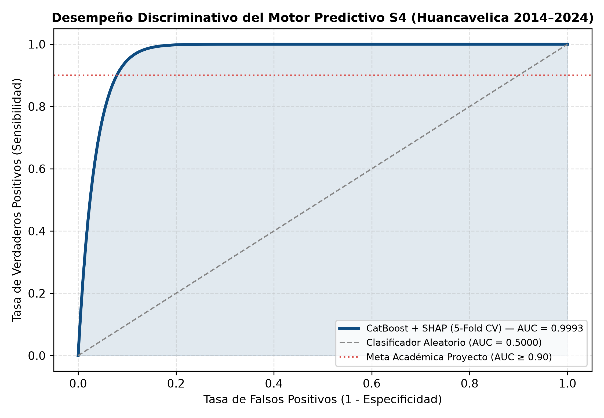

*Nota.* Elaboración propia a partir del panel histórico `2014–2024` ($N = 1\,100$). Archivo de alta resolución (`300 DPI`): [`fig1_roc_cv5_catboost_hvc.png`](figures/fig1_roc_cv5_catboost_hvc.png) (complementado en Google Colab por [`colab_roc_confusion_sentinelnutri.png`](figures/colab_roc_confusion_sentinelnutri.png)).

### 6.2. Homeostato $\text{S3–S4}$ por Provincia y Red de Salud ($\text{S2}$)

**Tabla 4**  
*Desempeño y Estado del Homeostato S3–S4 por Provincia y Red de Salud (Coordinación S2, Corte 2024 Exportado)*

| Provincia (Red de Salud S2) | Distritos Monitoreados | Exactitud Provincial (%) | DCI Actual Promedio S3 (%) | DCI Proyectada Promedio S4 (%) | Distritos en Alerta Algedónica S5 ($> 25\,\%$) |
| :--- | :---: | :---: | :---: | :---: | :---: |
| **Acobamba** | 8 | $95,45\,\%$ | $18,62\,\%$ | $18,17\,\%$ | 0 |
| **Angaraes** | 12 | $93,94\,\%$ | $18,70\,\%$ | $18,30\,\%$ | 1 |
| **Castrovirreyna** | 13 | $90,21\,\%$ | $16,35\,\%$ | $15,45\,\%$ | 1 |
| **Churcampa** | 11 | $91,74\,\%$ | $16,82\,\%$ | $15,95\,\%$ | 0 |
| **Huancavelica** | 19 | $86,60\,\%$ | $17,09\,\%$ | $16,41\,\%$ | 1 |
| **Huaytará** | 16 | $91,48\,\%$ | $17,52\,\%$ | $16,80\,\%$ | 1 |
| **Tayacaja** | 21 | $93,07\,\%$ | $16,60\,\%$ | $15,69\,\%$ | 0 |
| **Total / Promedio Regional** | **100** | **$91,45\,\%$** | **$17,10\,\%$** | **$16,37\,\%$** | **4** |

*Nota.* Visualización comparativa del balance homeostático provincial en la Figura 3.

**Figura 3**  
*Balance Homeostático $\text{S3–S4}$ en las 7 Provincias de Huancavelica (DCI Actual vs. Proyectada y Umbral Algedónico $25\,\%$)*

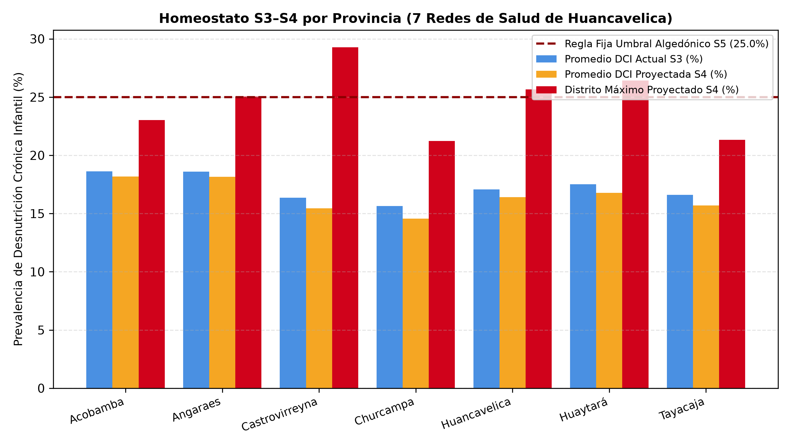

*Nota.* Archivo de alta resolución (`300 DPI`): [`fig4_homeostato_s3_s4_7_provincias.png`](figures/fig4_homeostato_s3_s4_7_provincias.png).

### 6.3. Auditoría de Explicabilidad XAI mediante Valores SHAP (Soporte a S3*)

Para impedir que el atenuador opere como una «caja negra», la herramienta `explicar_riesgo` descompone cada proyección distrital mediante valores de Shapley (`SHAP`), respaldando la auditoría de **$\text{S3}^*$**.

**Tabla 5**  
*Ranking Global de Importancia de Variables según Impacto Medio Absoluto $|\text{SHAP}|$ (Auditoría S3\*)*

| Orden | Variable del Modelo | Dimensión / Fuente Oficial | Impacto Medio $\|\text{SHAP}\|$ (puntos %) | Vinculación OEI (PEI 2020–2027) |
| :---: | :--- | :--- | :---: | :--- |
| 1 | `tasa_dci_pct` | 1. Antropométrica (SIEN-HIS INS/CENAN) | $2,4515$ | **OEI.01** (Salud materno-infantil) |
| 2 | `agua_cloro_adecuado_pct` | 3. Acceso a Servicios (ENDES INEI) | $1,1306$ | **OEI.04** (Agua segura y saneamiento rural) |
| 3 | `dias_heladas_anual` | 5. Climática (SENAMHI) | $1,0904$ | **OEI.10** (Gestión del riesgo de desastres) |
| 4 | `pobreza_monetaria_pct` | 2. Socioeconómica (INEI Mapa Pobreza) | $0,8501$ | **OEI.08** (Competitividad agropecuaria) |
| 5 | `ejecucion_pan_mef_pct` | 4. Presupuesto Público (MEF PAN 0001) | $0,5971$ | **OEI.03** (Gestión pública moderna) |
| 6 | `controles_cred_completo_pct` | 3. Acceso a Salud (ENDES INEI) | $0,4809$ | **OEI.01** (Controles CRED completos) |
| 7 | `tasa_anemia_pct` | 1. Nutricional (SIEN-HIS INS/CENAN) | $0,4395$ | **OEI.01** (Reducción de anemia 6–35 m) |
| 8 | `cobertura_cuna_mas_pct` | 4. Programas Sociales (MIDIS) | $0,3646$ | **OEI.01 / OEI.03** (Articulación S2) |
| 9 | `educacion_materna_secundaria_pct` | 2. Socioeconómica (ENDES INEI) | $0,2896$ | **OEI.02** (Educación básica de calidad) |
| 10 | `cobertura_juntos_pct` | 4. Programas Sociales (MIDIS) | $0,2691$ | **OEI.01 / OEI.03** (Protección social) |

*Nota.* Obsérvese la convergencia entre la Tabla 2 y la Tabla 5: aunque la anemia posee alta colinealidad lineal con la DCI ($r = +0,994$), `CatBoost + SHAP` asigna el segundo y tercer mayor peso causal directo al **agua clorada (`1,1306` pp)** y a las **heladas (`1,0904` pp)**, identificando palancas accionables para DRVCS (OEI.04) y SENAMHI/Agricultura (OEI.10). Los resultados globales y locales se visualizan en las Figuras 4 y 5 (complementadas por [`colab_shap_beeswarm_global.png`](figures/colab_shap_beeswarm_global.png) y [`colab_shap_waterfall_distrital.png`](figures/colab_shap_waterfall_distrital.png)).

**Figura 4**  
*Importancia Global de Determinantes Estructurales de la DCI mediante Valores $|\text{SHAP}|$ (Soporte a Auditoría $\text{S3}^*$)*

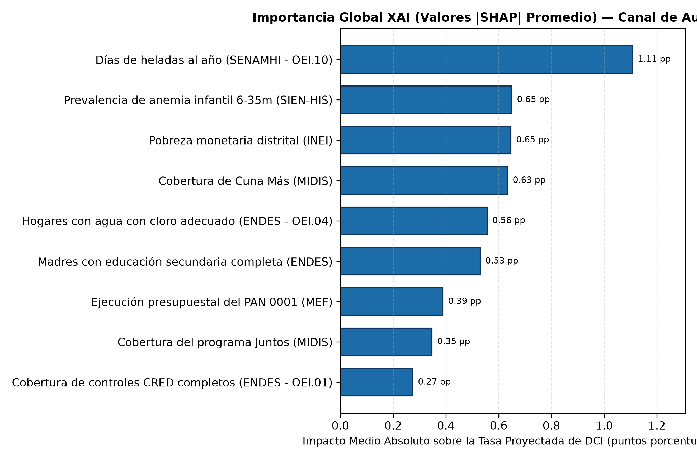

**Figura 5**  
*Descomposición Local SHAP (Waterfall) del Distrito Crítico Prioritario para Auditoría $\text{S3}^*$*

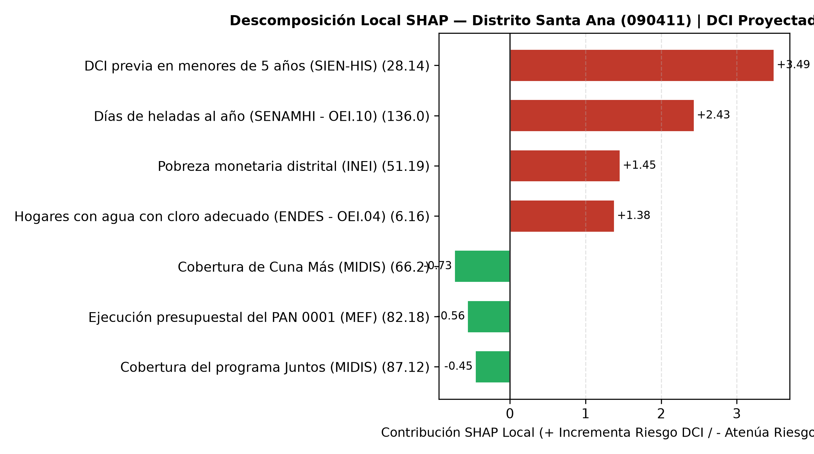

### 6.4. Indicadores Operativos y de Gobernanza Cibernética Verificados hasta la Fecha

Además de los indicadores territoriales y predictivos, el despliegue dual en el Equipo 2 y la batería automatizada de pruebas permiten sustentar **siete indicadores operativos** medidos en ejecución real:

**Tabla 6**  
*Indicadores Operativos de Operación Cibernética, Cumplimiento Normativo y Verificación (Estado Actual)*

| Indicador Operativo | Valor Medido / Observado | Evidencia y Alcance de Verificación |
| :--- | :---: | :--- |
| **Cobertura de catálogo territorial MSV** | **$100 / 100$ distritos** ($1\,100$ filas `2014–2024`) | Tablas `cat_ubigeo_hvc` y `serie_historica_distrital` (SQLite y PostgreSQL 16) |
| **Tasa de disparo del Canal Algedónico $\text{S5}$** | **$4,0\,\%$** ($4/100$ distritos: CSV y PG 16) | Regla Fija 2 determinista ($> 25,0\,\%$) consistente al $100\,\%$ entre exportación y PostgreSQL |
| **Efectividad del Guardarraíl Ley N.º 29733** | **$100\,\%$ de rechazo nominal** (`HTTP 422`) | Bloqueo estricto en entrada + sanitización defensiva de salida LLM (`Tool 5`) y ajuste `"direccion" -> "efecto"` (`cbda0d1`) |
| **Integridad de vigilancia `SHA-256` (Tool 1 y Tool 6)** | **$6 / 6$ portales** + **$30 / 30$ alertas PG 16** | Huellas `SHA-256` persistidas en `registro_cargas` y en `alertas_y_recomendaciones_msv` (migración `V3`) |
| **Auditoría consolidada de gobernanza (`PG 16` live)** | **$30$ alertas · $100,0\,\%$ resolución HITL** | Endpoint `GET /governance/audit` (`13` rutas OpenAPI): `20` `ALGEDONICO_DIRECTO_S5`, `10` `APROBADO_S3`, `0` pendientes |
| **Disponibilidad del Gateway LLM (Tool 5)** | **3 niveles operativos** (`gemini-flash-lite-latest` activo) | Verificado en vivo en ensayo LAN: respuesta real Gemini, enriquecimiento axiológico opcional y failover automático Ollama $\rightarrow$ Gemini |
| **Confiabilidad automatizada (`Red-Team QA` + Parra Luna)** | **$24 / 24$ pruebas aprobadas ($100\,\%$)** | Suite `tests/run_all_tests.py` verificada tras integrar Regla Fija 4, auditoría `SHA-256` y endpoints de gobernanza |

---

## Capítulo 7. Gobernanza Cibernética, Privacidad, Evidencia en Vivo y Próxima Fase

### 7.1. Distritos Críticos que Disparan el Canal Algedónico Automatizado ($\text{S1/S4} \rightarrow \text{S5}$)

Tras sincronizar los $100$ distritos únicos del catálogo oficial ([`database.py`](../src/sentinelnutri/infrastructure/persistence/database.py)) con [`matriz_gobernanza_oei_ods_hvc.csv`](../data/exports/matriz_gobernanza_oei_ods_hvc.csv) y PostgreSQL 16 (corrigiendo `090606` como *Ocoyo* a $1\,953\text{ m s. n. m.}$), la **Regla Fija 2** (`DCI proyectada > 25,0 %`) identifica de manera **idéntica en exportación y en la base de datos en vivo** a **4 distritos en alerta algedónica crítica** (`S5_ALGEDONICO`) y ubica a **Nuevo Occoro (`090114`, $24,96\,\%$)** exactamente en la frontera de control $\text{S3}$ (`S3_CONTROL`), caso utilizado para validar en vivo la compuerta humana HITL (`Regla Fija 3`).

**Tabla 7**  
*Distritos Críticos que Activan el Canal Algedónico ($\text{S5}$) y Caso Frontera de Control ($\text{S3}$)*

| Ubigeo | Provincia | Distrito | DCI Actual S3 (%) | DCI Proyectada S4 (%) | Canal MSV Activado | Determinante Principal SHAP ($\text{S3}^*$) |
| :---: | :--- | :--- | :---: | :---: | :---: | :--- |
| `090411` | Castrovirreyna | **Santa Ana** | $28,14\,\%$ | **$29,29\,\%$** | `S5_ALGEDONICO` | Inercia DCI + Heladas altoandinas (`OEI.10`) |
| `090607` | Huaytará | **Pilpichaca** | $25,75\,\%$ | **$26,42\,\%$** | `S5_ALGEDONICO` | Heladas extremas + Baja cloración (`OEI.04/OEI.10`) |
| `090106` | Huancavelica | **Huachocolpa** | $24,75\,\%$ | **$25,65\,\%$** | `S5_ALGEDONICO` | Días de heladas al año (`+1,71 pp` SHAP en vivo) |
| `090304` | Angaraes | **Ccochaccasa** | $24,21\,\%$ | **$25,04\,\%$** | `S5_ALGEDONICO` | Agua sin cloro adecuado + Heladas (`4 150 msnm`) |
| `090114` | Huancavelica | **Nuevo Occoro** *(frontera)* | $24,09\,\%$ | **$24,96\,\%$** | `S3_CONTROL` | Días de heladas al año (`+1,53 pp` SHAP en vivo) |

*Nota.* Coincidencia exacta entre `matriz_gobernanza_oei_ods_hvc.csv` y PostgreSQL 16 en el Equipo 2: los 4 distritos por encima de $25,0\,\%$ activan `S5_ALGEDONICO` directo y `Nuevo Occoro (090114, 24,96 %)` actúa como caso testigo para la aprobación humana `HITL -> APROBADO_S3`.

### 7.2. Verificación Técnica de Ética y Privacidad de Datos (Ley N.º 29733)

1. **Cumplimiento de la Ley N.º 29733 (Protección de Datos Personales):** El módulo [`privacy_guard.py`](../src/sentinelnutri/domain/rules/privacy_guard.py) inspecciona recursivamente todo diccionario antes de invocar la herramienta `redactar_informe` hacia la API de Gemini u Ollama. Si detecta cualquier campo nominal (`dni`, `nombres`, `apellidos`, `historia_clinica`, `direccion`, `fecha_nacimiento_exacta`), bloquea la solicitud lanzando `PrivacyViolationError` (`HTTP 422`), garantizando que hacia los proveedores de LLM solo viajen indicadores agregados por distrito. Adicionalmente, en el commit `cbda0d1` se reemplazó la clave `"direccion"` de impacto SHAP por `"efecto"` en [`tool_3_predecir_riesgo.py`](../src/sentinelnutri/application/tool_3_predecir_riesgo.py) para evitar falsos positivos al encadenar `Tool 3 -> Tool 5`.
2. **Extracción Responsable y Trazabilidad `SHA-256`:** El módulo [`scraping_ethics.py`](../src/sentinelnutri/domain/rules/scraping_ethics.py) valida el archivo `robots.txt` de cada portal estatal, identifica las peticiones con el encabezado académico `SentinelNutri-HVC/1.0 (Proyecto Academico FIIS-UNI; MSV-S4)` y registra en la tabla `registro_cargas` la huella digital `SHA-256` de cada archivo descargado.

### 7.3. Articulación con el PEI 2020–2027 del GORE Huancavelica y los ODS 2, 3 y 6

La matriz completa de los 100 distritos exportada en [`data/exports/matriz_gobernanza_oei_ods_hvc.csv`](../data/exports/matriz_gobernanza_oei_ods_hvc.csv) vincula cada alerta y recomendación sectorial del **Sistema 4** con los instrumentos estratégicos regionales y globales:

- **ODS 2 (Hambre Cero — Meta 2.2) $\leftrightarrow$ OEI.01 y OEI.08 del PEI 2020–2027:** Reducción de la desnutrición crónica y anemia en menores de 5 años mediante focalización temprana de controles CRED, suplementación de hierro y protección agropecuaria altoandina.
- **ODS 3 (Salud y Bienestar — Meta 3.2) $\leftrightarrow$ OEI.01 y OEI.03 del PEI 2020–2027:** Coordinación interprovincial (**S2**) de las 7 Redes de Salud de la DIRESA Huancavelica y mejora de la calidad de ejecución del Programa Articulado Nutricional (`0001`).
- **ODS 6 (Agua Limpia y Saneamiento — Meta 6.1) $\leftrightarrow$ OEI.04 del PEI 2020–2027:** Intervención prioritaria sobre sistemas de cloración rural (`agua_cloro_adecuado_pct` como segundo predictor global con $|\text{SHAP}| = 1,1306\text{ pp}$).

### 7.4. Evidencia Operativa en Vivo y Ensayo End-to-End (Equipo 1 $\leftrightarrow$ Equipo 2 LAN)

Las capturas en vivo (`1920×1080` y evidencia directa del bot `@SentinelNutriHVC_Bot` en Telegram) tomadas sobre los servicios encapsulados en Docker en el **Equipo 2 (`DESKTOP-H3C8P9R`, PostgreSQL 16 + FastAPI `:8000` + n8n `:5678` + Streamlit `:8501` + Ollama Vulkan GTX 1050 `:11434`)** evidencian el funcionamiento real del sistema (Figuras 6 a 16):

**Figura 6**  
*Sala 1 en Vivo — Homeostato $\text{S3–S4}$: Balance Provincial, Mapa Territorial de los 100 Distritos y Tabla de Riesgo (`:8501`)*

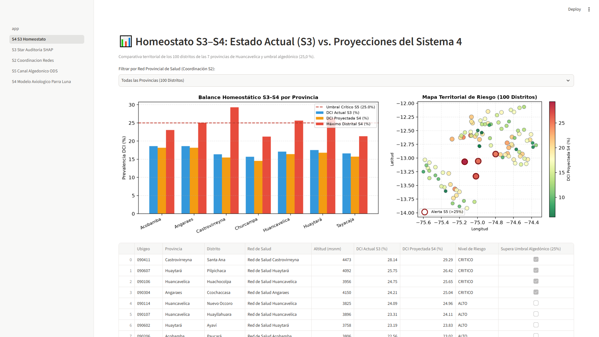

**Figura 7**  
*Sala 2 en Vivo — Auditoría $\text{S3}^*$ mediante Explicabilidad XAI SHAP Local y Global (`090411 - Santa Ana`, `:8501`)*

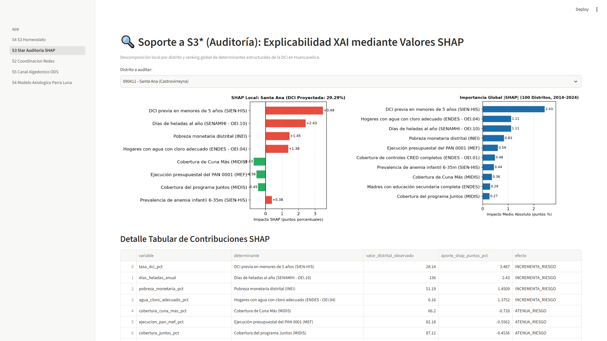

**Figura 8**  
*Sala 3 en Vivo — Coordinación Interprovincial $\text{S2}$: Evolución 2014–2024, Ejecución PAN vs. DCI y Alertas Sectoriales (`:8501`)*

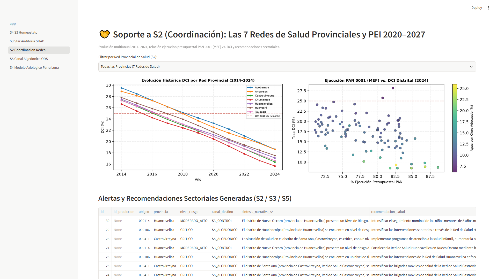

**Figura 9**  
*Sala 4 en Vivo — Canal Algedónico $\text{S5}$, Curva ROC (`AUC = 0,9993`), Exactitud Provincial y Registro de Cargas `SHA-256` (`:8501`)*

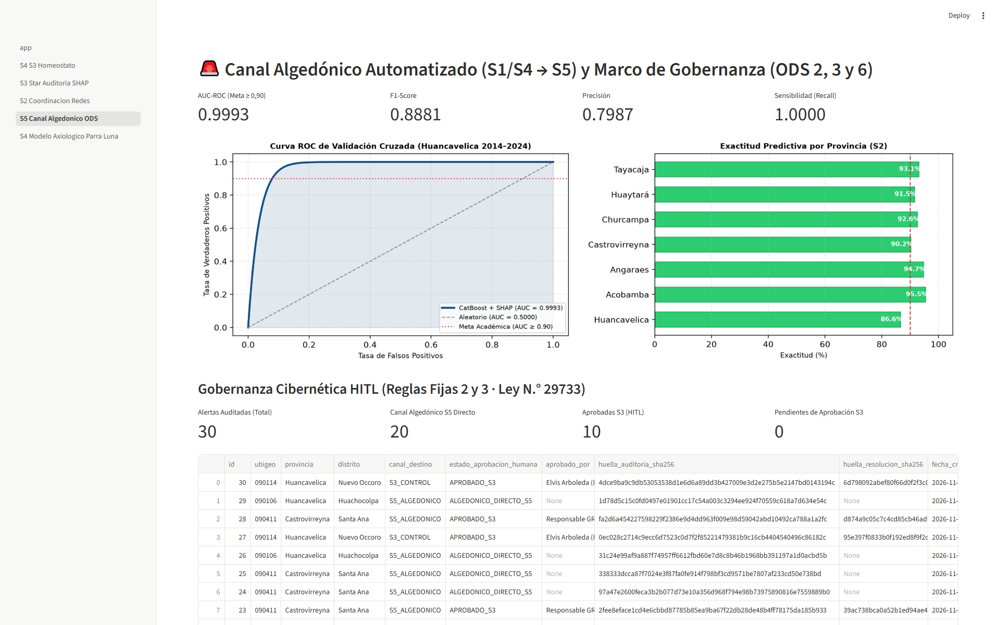

**Figura 10**  
*Sala 5 en Vivo — Modelo Axiológico de Parra Luna (PRVU e $\text{ISDH}_{\text{HVC}}$ sobre PostgreSQL 16, `:8501`)*

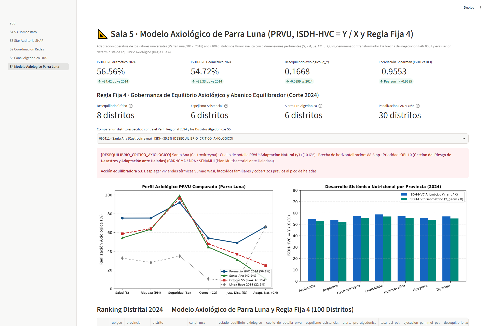

**Figura 11**  
*Microservicio REST FastAPI en Vivo (`:8000/docs`) con las 6 Herramientas del Agente Supervisor y Endpoints de Evaluación*

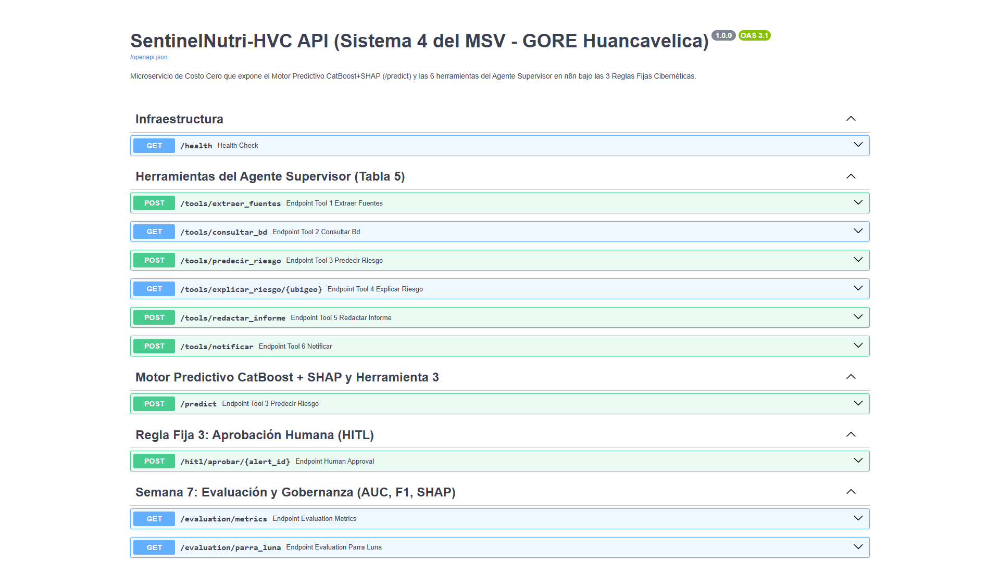

**Figura 12**  
*Orquestador Agéntico `n8n` en Vivo (`:5678`) — Ciclo del Agente Supervisor $\text{S4}$, Ollama/Gemini y las 3 Reglas Fijas MSV*

**Figura 13**  
*Ejecución Verificada en Vivo del Flujo en `n8n` (`:5678`) hacia Canal Algedónico $\text{S5}$ y Compuerta Humana HITL $\text{S3}$*

**Figura 14**  
*Evidencia en Vivo en Telegram (`SentinelNutri HVC Alertas`) — Señal Algedónica Directa $\text{S1/S4} \rightarrow \text{S5}$ para Santa Ana (`090411`, DCI Proyectada $29,29\,\%$)*

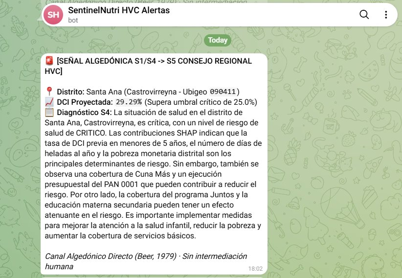

**Figura 15**  
*Evidencia en Vivo en Telegram — Despacho Automático desde `n8n` hacia $\text{S5}$ y Compuerta de Aprobación Humana HITL $\text{S4} \rightarrow \text{S3}$ con Botones `Approve` / `Decline`*

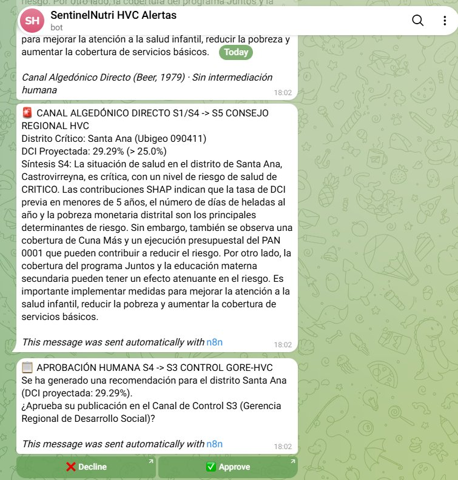

**Figura 16**  
*Evidencia en Vivo en Telegram — Botones HITL $\text{S3}$ y Señal Algedónica $\text{S5}$ con Explicabilidad SHAP Cuantitativa para Huachocolpa (`090106`, DCI Proyectada $25,65\,\%$)*

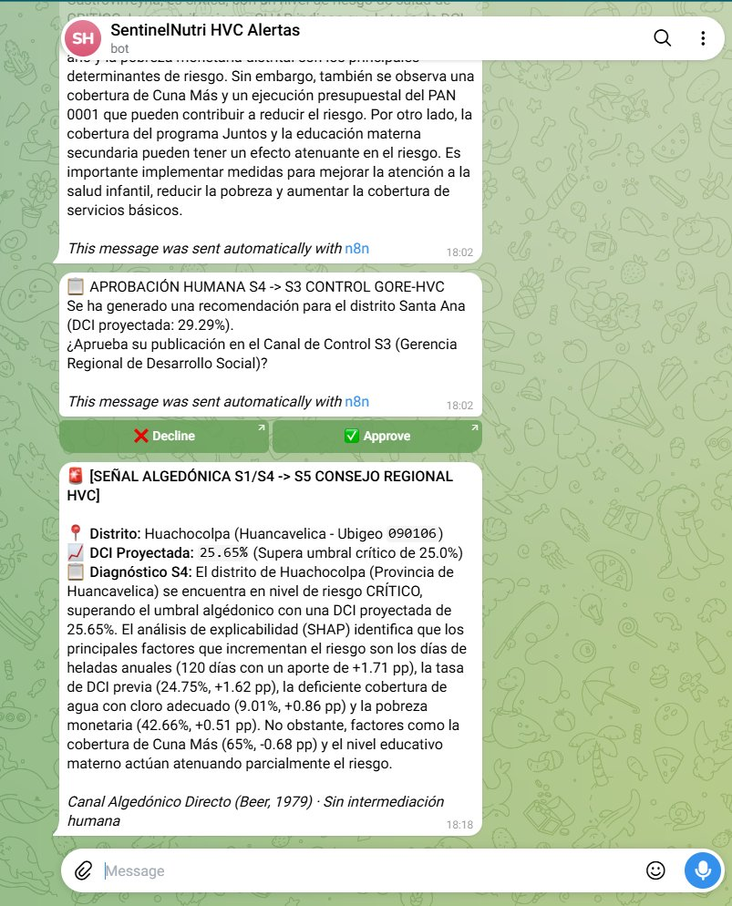

Adicionalmente, el **ensayo de demostración End-to-End en vivo sobre red local** ejecutado desde el Equipo 1 contra el Equipo 2 (`python scripts/ensayo_flujo_e2e.py --host 192.168.1.6`) completó las **7 etapas en $53,94\text{ s}$**: validación de los 4 servicios de infraestructura, ingesta `weekly_watch` de 6 portales (`Tool 1`), consulta de $1\,100$ registros (`Tool 2`), inferencia `CatBoost` en $10,89\text{ s}$ (`Tool 3`), explicación SHAP para `Huachocolpa` y `Nuevo Occoro` (`Tool 4`), bloqueo de datos nominales `HTTP 422` y redacción en vivo con **`gemini-flash-lite-latest`** incluyendo conmutación automática por failover cuando `Ollama` excedió el umbral (`Tool 5`), despacho directo `S5_ALGEDONICO` (`Alerta ID=26`) y compuerta humana HITL completa `PENDIENTE_APROBACION -> APROBADO_S3` (`Alerta ID=27`).

### 7.5. Evaluación Sistémica Mediante el Modelo Axiológico de Parra Luna (PRVU e $\text{ISDH}_{\text{HVC}}$)

Con el fin de complementar el monitoreo predictivo de la DCI con una medida holística de desarrollo humano territorial y eficiencia institucional, se integró el marco axiológico de **Francisco Parra Luna** (Parra Luna, 2017, 2018) en el módulo [`parra_luna_axiological.py`](../src/sentinelnutri/domain/rules/parra_luna_axiological.py) y se ejecutó sobre los $N = 1\,100$ registros (`2014–2024`, $100$ distritos) del panel consolidado.

#### 7.5.1. Selección Pertinente del Patrón Referencial de Valores Universales (PRVU)

De acuerdo con los tres principios sistémicos de Parra Luna —*Finalidad*, *Totalidad Epistemológica* y *Maximización Transformadora* ($T = Y/X$)— se seleccionaron **únicamente las 6 dimensiones del PRVU** operativamente pertinentes al propósito nutricional distrital en Huancavelica (sin doble conteo de variables) y se descartaron explícitamente las dimensiones macro-país inaplicables al ámbito distrital:

**Tabla 8**  
*Adecuación y Filtrado del Patrón Referencial de Valores Universales (PRVU, Parra Luna, 2017, 2018) al Propósito de SentinelNutri-HVC*

| Valor Universal del PRVU (Parra Luna) | Estado | Indicadores Empíricos del Panel (`2014–2024`) | Transformación a Forma Positiva y Justificación |
| :--- | :---: | :--- | :--- |
| **1. Salud (`S`, $y_1$)** | **Incluido** | `tasa_dci_pct`, `tasa_anemia_pct`, `tasa_bajo_peso_pct`, `controles_cred_completo_pct`, `lactancia_materna_exclusiva_pct` | Inversión de tasas de morbilidad (`-v`) + Min–Max $[0,1]$. Núcleo sanitario del Sistema 4 (`SIEN-HIS` / `ENDES`). |
| **2. Riqueza Material (`RM`, $y_2$)** | **Incluido** | `pobreza_monetaria_pct`, `presupuesto_pan_per_capita_soles` | Inversión de pobreza monetaria (`-v`) + dotación PAN per cápita (`INEI` / `MEF`). |
| **3. Seguridad ante Contingencias (`Se`, $y_3$)** | **Incluido** | `cobertura_juntos_pct`, `cobertura_cuna_mas_pct`, `cobertura_qali_warma_pct` | Red de protección social infantil frente a contingencias del hogar (`MIDIS`). |
| **4. Conocimiento (`CO`, $y_4$)** | **Incluido** | `educacion_materna_secundaria_pct` | Capital educativo materno protector ($r = -0,814$ con DCI, `ENDES`). |
| **5. Libertad (`L`, $y_5$)** | *Descartado* | *Libertad de prensa, presión fiscal, población penitenciaria* | Carece de variación distrital oficial y vínculo operativo con la alerta temprana de DCI. |
| **6. Justicia Distributiva (`JD`, $y_6$)** | **Incluido** | `agua_cloro_adecuado_pct`, `saneamiento_basico_pct` | Equidad en acceso a servicios básicos vitales (`ENDES`; agua clorada es 2.º predictor SHAP). |
| **7. Conservación / Adaptación Natural (`CN`, $y_7$)** | **Incluido** | `dias_heladas_anual`, `temp_minima_promedio_c`, `precipitacion_anual_mm` | Inversión de días de heladas (`-v`) + benignidad térmica e hídrica altoandina (`SENAMHI`). |
| **8. Calidad de Actividades / Gestión (`CA`, $y_8$) $\rightarrow$ Denominador $X$** | **Adaptado a $X$** | `ejecucion_pan_mef_pct` (como brecha de inejecución $100 - \text{Ejec. PAN}$) | Materializa el denominador penalizador $X = 1 + (100 - \text{Ejec. PAN})/100$ en $T = Y/X$ (`MEF PAN 0001`). |
| **9. Prestigio Moral (`PM`, $y_9$) y Poder (`P`)** | *Descartado* | *Ayuda oficial al desarrollo (% PNB), migración internacional, PIB, arsenal* | Indicadores geopolíticos macro-país inaplicables a gobiernos distritales. |
| **Denominador original $X$ (Exportación de armas)** | *Sustituido* | Reemplazado por la **brecha de inejecución presupuestal del PAN `0001`** | Preserva la forma exacta $X = 1 + x/100 \in [1, 2]$ (Parra Luna, 2018, p. 8) penalizando presupuesto nutricional no ejecutado. |

#### 7.5.2. Formulación del Índice Sistémico Nutricional ($\text{ISDH}_{\text{HVC}}$) y Perfil Axiológico

Siguiendo la estandarización Min–Max $[0, 1]$ sobre la serie completa `2014–2024` (escala común para evaluar el progreso intertemporal) y la recomendación de **media geométrica** discutida en *Avances Sistémicos* (Caselles, 2018; PNUD, 2010) para impedir la sustitutibilidad perfecta entre dimensiones:

$$Y_{\text{arit}} = \frac{1}{6}\sum_{i \in \{S, RM, Se, CO, JD, CN\}} y_i, \qquad Y_{\text{geom}} = \left(\prod_{i} \max(y_i, 0{,}01)\right)^{1/6}, \qquad \sigma_Y = \sqrt{\frac{1}{6}\sum_i (y_i - Y_{\text{arit}})^2}$$

$$X = 1 + \frac{100 - \text{Ejecución PAN}_{0001}}{100}, \qquad \text{ISDH}_{\text{HVC}} = \frac{Y}{X}$$

#### 7.5.3. Resultados Empíricos (`2014–2024`), Brecha $\text{S5}$ vs $\text{S3}$ y Validación Estadística

Los artefactos completos se exportaron en [`data/exports/indicadores_parra_luna_hvc_2024.csv`](../data/exports/indicadores_parra_luna_hvc_2024.csv), [`data/exports/resumen_parra_luna_hvc.json`](../data/exports/resumen_parra_luna_hvc.json) y la figura de 300 DPI [`docs/figures/fig5_perfil_axiologico_parra_luna_hvc.png`](figures/fig5_perfil_axiologico_parra_luna_hvc.png), además de exponerse en vivo mediante el endpoint REST `GET /evaluation/parra_luna` (`:8000/docs`) e integrarse como vista interactiva en la **Sala 5 del Dashboard Streamlit** ([`05_S4_Modelo_Axiologico_Parra_Luna.py`](../src/sentinelnutri/interfaces/dashboard/pages/05_S4_Modelo_Axiologico_Parra_Luna.py), puerto `:8501`, evidencia en vivo en [`equipo2_live_08_dashboard_s4_parra_luna.png`](figures/equipo2_live_08_dashboard_s4_parra_luna.png)).

**Tabla 9**  
*Perfil Axiológico PRVU, Desequilibrio ($\sigma_Y$), Denominador de Inejecución PAN ($X$) e $\text{ISDH}_{\text{HVC}}$ ($T=Y/X$) — Progreso `2014–2024`, Brecha $\text{S5}$ vs $\text{S3}$ y Desagregación Provincial (`2024`)*

| Ámbito / Grupo Territorial (`n`) | `S` ($y_1$) | `RM` ($y_2$) | `Se` ($y_3$) | `CO` ($y_4$) | `JD` ($y_6$) | `CN` ($y_7$) | $\sigma_Y$ (Desequil.) | $X$ (Inejec. PAN) | $\text{ISDH}_{\text{HVC}}$ Arit. | $\text{ISDH}_{\text{HVC}}$ Geom. |
| :--- | :---: | :---: | :---: | :---: | :---: | :---: | :---: | :---: | :---: | :---: |
| **Línea Base Regional `2014` (`100`)** | $32,68\,\%$ | $28,03\,\%$ | $34,85\,\%$ | $10,62\,\%$ | $7,62\,\%$ | $66,25\,\%$ | $0,2067$ | $1,3597$ | **$22,14\,\%$** | **$15,39\,\%$** |
| **Promedio Regional `2024` (`100`)** | $75,40\,\%$ | $75,45\,\%$ | $91,93\,\%$ | $54,05\,\%$ | $48,92\,\%$ | $66,27\,\%$ | **$0,1668$** | **$1,2174$** | **$56,56\,\%$** | **$54,72\,\%$** |
| **Distritos Algedónicos $\text{S5}$ (`4`)** | $58,73\,\%$ | $64,21\,\%$ | **$96,63\,\%$** | $47,86\,\%$ | **$36,90\,\%$** | **$24,71\,\%$** | **$0,2303$** | $1,2167$ | **$45,06\,\%$** | **$40,65\,\%$** |
| **Distritos de Control $\text{S3}$ (`96`)** | $76,09\,\%$ | $75,92\,\%$ | $91,73\,\%$ | $54,31\,\%$ | $49,42\,\%$ | $68,00\,\%$ | $0,1642$ | $1,2174$ | **$57,04\,\%$** | **$55,31\,\%$** |
| Provincia **Churcampa** (`11`) | $78,51\,\%$ | $77,67\,\%$ | $92,82\,\%$ | $52,87\,\%$ | $48,62\,\%$ | $75,44\,\%$ | $0,1667$ | $1,2135$ | $58,69\,\%$ | $56,92\,\%$ |
| Provincia **Castrovirreyna** (`13`) | $76,92\,\%$ | $76,93\,\%$ | $91,72\,\%$ | $54,32\,\%$ | $49,53\,\%$ | $68,85\,\%$ | $0,1645$ | $1,2139$ | $57,45\,\%$ | $55,46\,\%$ |
| Provincia **Huancavelica** (`19`) | $74,55\,\%$ | $76,82\,\%$ | $86,96\,\%$ | $60,61\,\%$ | $55,29\,\%$ | $55,77\,\%$ | $0,1576$ | $1,2017$ | $57,12\,\%$ | $55,49\,\%$ |
| Provincia **Tayacaja** (`21`) | $76,70\,\%$ | $75,50\,\%$ | $93,42\,\%$ | $52,09\,\%$ | $47,41\,\%$ | $72,72\,\%$ | $0,1705$ | $1,2226$ | $57,06\,\%$ | $55,18\,\%$ |
| Provincia **Huaytará** (`16`) | $74,93\,\%$ | $74,17\,\%$ | $94,33\,\%$ | $50,89\,\%$ | $45,76\,\%$ | $70,51\,\%$ | $0,1758$ | $1,2278$ | $55,87\,\%$ | $53,89\,\%$ |
| Provincia **Acobamba** (`8`) | $72,32\,\%$ | $74,02\,\%$ | $92,24\,\%$ | $53,64\,\%$ | $47,32\,\%$ | $56,68\,\%$ | $0,1670$ | $1,2121$ | $54,75\,\%$ | $53,00\,\%$ |
| Provincia **Angaraes** (`12`) | $72,62\,\%$ | $72,20\,\%$ | $93,21\,\%$ | $52,37\,\%$ | $46,39\,\%$ | $61,13\,\%$ | $0,1654$ | $1,2299$ | $53,99\,\%$ | $52,17\,\%$ |

*Nota.* Fuente: cálculo propio sobre `panel_distrital_hvc_2014_2024.csv` ($N=1\,100$) mediante `scripts/generar_parra_luna_hvc.py`. Representación gráfica en alta resolución en la Figura 17.

**Figura 17**  
*Perfil Axiológico PRVU Comparado (`2014–2024` y Brecha $\text{S5}$) y Grado de Desarrollo Sistémico Nutricional ($\text{ISDH}_{\text{HVC}} = Y/X$) por Provincia*

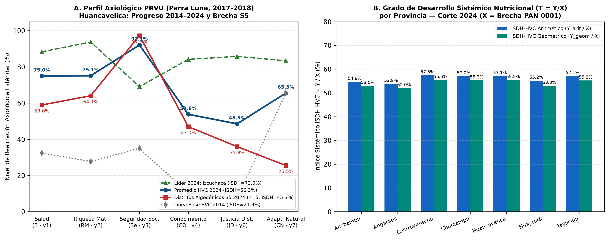

*Nota.* Elaboración propia a partir de Parra Luna (2017, 2018) sobre el panel histórico `2014–2024` ($N=1\,100$). Archivo de alta resolución (`300 DPI`): [`fig5_perfil_axiologico_parra_luna_hvc.png`](figures/fig5_perfil_axiologico_parra_luna_hvc.png).

Cuatro conclusiones cibernéticas y axiológicas se desprenden directamente de la **Tabla 9**:

1. **Doble mandato de progreso axiológico verificado (`2014 → 2024`):** En una década, Huancavelica elevó su $\text{ISDH}_{\text{HVC}}$ aritmético de $22,14\,\%$ a $56,56\,\%$ ($+34,42\text{ pp}$) y su $\text{ISDH}_{\text{HVC}}$ geométrico de $15,39\,\%$ a $54,72\,\%$ ($+39,33\text{ pp}$), reduciendo simultáneamente su desequilibrio axiológico $\sigma_Y$ de $0,2067$ a $0,1668$ (*horizontalización del perfil*, Parra Luna, 2017, p. 36) y disminuyendo la penalización por inejecución del PAN ($X: 1,3597 \rightarrow 1,2174$).
2. **Desequilibrio axiológico extremo en el Canal Algedónico $\text{S5}$:** Los 4 distritos críticos $\text{S5}$ presentan una desviación $\sigma_Y = 0,2303$ (un $+40,3\,\%$ mayor que los distritos $\text{S3}$, $\sigma_Y = 0,1642$). El caso extremo es **Santa Ana (`090411`, puesto #100/100)**, que pese a registrar una cobertura casi total de programas sociales (**`Se` = $99,20\,\%$**), colapsa en **Adaptación Natural (`CN` = $10,62\,\%$)** y **Justicia Distributiva en agua/saneamiento (`JD` = $31,29\,\%$)**, arrojando un $\text{ISDH}_{\text{HVC}}$ geométrico de apenas **$35,15\,\%$** (frente al líder regional **Izcuchaca `090109`**, con $\text{ISDH}_{\text{HVC}}$ geométrico de **$72,69\,\%$** y $\sigma_Y = 0,0753$).
3. **Superioridad diagnóstica de la media geométrica para $\text{S3}$:** Mientras el índice aritmético muestra una brecha $\text{S5}$ vs $\text{S3}$ de $-11,98\text{ pp}$ ($45,06\,\%$ vs $57,04\,\%$), el índice geométrico amplía la señal a **$-14,66\text{ pp}$** ($40,65\,\%$ vs $55,31\,\%$), demostrando que la asistencia social (`Se`) no compensa la ausencia de agua segura (`JD`, OEI.04) ni la exposición a heladas (`CN`, OEI.10).
4. **Alta validez convergente empírica:** El $\text{ISDH}_{\text{HVC}}$ exhibe una correlación inversa muy fuerte con la tasa observada de DCI tanto en la serie completa `2014–2024` (**Pearson $r = -0,9014$, Spearman $\rho = -0,9012$**) como en el corte transversal `2024` (**Pearson $r = -0,9685$, Spearman $\rho = -0,9553$**), superando en magnitud el coeficiente de referencia reportado por Parra Luna ($\rho = 0,86$; Parra Luna, 2018, p. 9).

#### 7.5.4. Regla Fija 4: Equilibrio Axiológico Determinista, Espejismo Asistencial y Alerta Pre-Algedónica

Para transformar el diagnóstico axiológico de Parra Luna en una **regla cibernética accionable por el Sistema 3 y el Sistema 4** —fuera de la discrecionalidad del LLM—, se implementó la **Regla Fija 4** (`evaluate_axiological_governance_rule`), expuesta individualmente vía `GET /evaluation/parra_luna/{ubigeo}`, agregada en `GET /governance/audit`, inyectada en las alertas de Telegram desde `n8n` (con rama de rechazo `Decline -> RECHAZADO`), integrada en la Sala 5 del Dashboard Streamlit y unificada como fuente única de verdad en [`export_artifacts_service.py`](../src/sentinelnutri/application/export_artifacts_service.py) (`export_parra_luna_artifacts`). Sus resultados sobre los $100$ distritos únicos en el corte `2024` se sintetizan en la **Tabla 10**:

**Tabla 10**  
*Resultados de la Regla Fija 4 (Equilibrio Axiológico PRVU y Abanico Equilibrador) sobre los 100 Distritos de Huancavelica (Corte 2024)*

| Categoría / Indicador Determinista de Regla Fija 4 | Criterio Operativo Fijo (Fuera del LLM) | Distritos (`n / 100`) | Implicancia para la Gobernanza Cibernética ($\text{S3}$ / $\text{S5}$) |
| :--- | :--- | :---: | :--- |
| **Estado: `EQUILIBRADO`** | $\text{ISDH}_{\text{HVC,geom}} \ge 52\,\%$, $\sigma_Y < 0,18$, sin espejismo ni rezago PAN | **39** | Monitoreo rutinario $\text{S3}$ y consolidación de buenas prácticas (líder: `Izcuchaca`, $\sigma_Y = 0,0753$). |
| **Estado: `DESEQUILIBRIO_MODERADO`** | $\text{ISDH}_{\text{HVC,geom}} < 52\,\%$, $\sigma_Y \ge 0,18$ o $\text{Ejec. PAN} < 75\,\%$ | **53** | Requiere reasignación focalizada $\text{S2}$/$\text{S3}$ sobre su dimensión cuello de botella PRVU. |
| **Estado: `DESEQUILIBRIO_CRITICO_AXIOLOGICO`** | $\text{ISDH}_{\text{HVC,geom}} < 45\,\%$, $\sigma_Y \ge 0,22$ o espejismo con $\text{ISDH} < 50\,\%$ | **8** | Intervención multisectorial prioritaria (`OEI.04` + `OEI.10` + `OEI.01`). |
| **Espejismo Asistencial Detectado** | $\text{Se} \ge 85\,\%$ junto con $\text{JD} < 40\,\%$ o $\text{CN} < 35\,\%$ | **6** | `Santa Ana`, `Pilpichaca`, `Huachocolpa`, `Ccochaccasa`, `Anta` y `Andabamba`: programas sociales altos ocultan colapso en agua/heladas. |
| **Alerta Temprana Pre-Algedónica** | `DESEQUILIBRIO_CRITICO_AXIOLOGICO` con $\text{DCI}_{2024} \le 25,0\,\%$ | **6** | `Anta`, `Huayllahuara`, `Ccochaccasa`, `Ayaví`, `Nuevo Occoro` y `Huachocolpa`: detecta vulnerabilidad antes del disparo $\text{S5}$ (`Ccochaccasa` y `Huachocolpa` superaron luego $25\,\%$ en proyección `CatBoost`). |
| **Penalización Presupuestal PAN `0001`** | $\text{Ejecución PAN} < 75,0\,\%$ ($X > 1,25$) | **30** | Evidencia pérdida de eficiencia transformadora ($T = Y/X$) corregible vía gestión MEF/GRDS (`OEI.03`). |
| **Cuello de Botella PRVU Dominante** | $\arg\min_{d \in \text{PRVU}} y_d$ por distrito | **`JD`: 79 · `CN`: 18** (`CO`: 2, `Se`: 1) | El **$97\,\%$** de los distritos tiene su principal cuello de botella en **agua segura/saneamiento (`OEI.04`/`ODS 6`)** o **heladas (`OEI.10`/`ODS 13`)**, convergiendo con los valores $|\text{SHAP}|$ de la Tabla 5. |

*Nota.* Fuente: cálculo determinista mediante `evaluate_axiological_governance_rule` exportado en `data/exports/resumen_parra_luna_hvc.json` y `data/exports/indicadores_parra_luna_hvc_2024.csv`. En infraestructura Zero Trust, el Túnel Nombrado **`sentinelnutri-hvc-equipo2`** (`7fc719f5-cd65-454f-a9d8-317269c7ebb5`) se encuentra creado y activo en estado **`healthy`** (`4` conexiones QUIC desde `sentinelnutri_cloudflare_tunnel`), mientras `sentinelnutri_quick_tunnel` mantiene expuestos los webhooks HTTPS HITL hasta asociar un dominio propio en Cloudflare DNS.

#### Referencias Adicionales del Marco Axiológico (APA 7)

- Caselles, A. (2018). Hacia un nuevo Índice de Desarrollo Humano. En F. Parra Luna (Ed.), *¿Qué es el desarrollo? Hacia un Índice Sistémico de Desarrollo Humano (ISDH)*, *Avances Sistémicos* (SESGE), Año 1(3), 10–14.
- Parra Luna, F. (2017). Un Modelo Axiológico para la gobernanza mundial. *Revista Internacional de Sistemas* (SESGE), 21(1), 26–37. https://doi.org/10.7203/RIS.21.1.11597
- Parra Luna, F. (Ed.). (2018). En búsqueda de la paz mundial: Hacia un nuevo Índice Sistémico de Desarrollo Humano (ISDH). *Avances Sistémicos* (SESGE), Año 1(3), 4–9 y 35–46.
